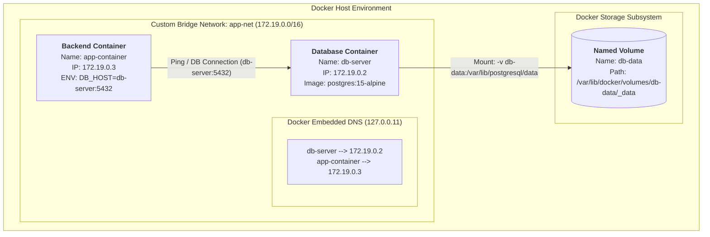

# BÀI 4: THIẾT LẬP CUSTOM NETWORK & NAMED VOLUME BẰNG DOCKER CLI

* **Môn học**: IT209 - DevOps / Containerization
* **Bài tập**: Session 10 - Exercise 4
* **Đường dẫn nộp bài**: `homework/session_10/ex4/`
* **Tài liệu nộp**: [commands.sh](file:///e:/BaiTap/IT209_Devops/Session10/Ex4/commands.sh), [README.md](file:///e:/BaiTap/IT209_Devops/Session10/Ex4/README.md)

---

## 1. MỤC TIÊU BÀI THỰC HÀNH

1. **Custom Bridge Network**: Tạo mạng người dùng định nghĩa (`app-net`) để kích hoạt cơ chế **Automatic Service Discovery / DNS Resolution** nội bộ của Docker Engine. Cho phép các Container giao tiếp an toàn, bảo mật thông qua tên service (`db-server`) thay vì phụ thuộc vào địa chỉ IP động.
2. **Named Volume**: Tạo Volume mang tên (`db-data`) do Docker quản lý để lưu trữ dữ liệu bền vững (**Data Persistence**) tại thư mục `/var/lib/postgresql/data`. Dữ liệu tồn tại độc lập với vòng đời của Container.
3. **Mô phỏng cụm 2 Containers (2-Tier Architecture)**:
   * **Database Container**: `db-server` (chạy PostgreSQL 15 Alpine).
   * **Backend Container**: `app-container` (chạy Alpine Linux với biến môi trường kết nối trỏ tới hostname `db-server`).
4. **Kiểm chứng Data Persistence & DNS**:
   * Kiểm tra `app-container` ping thành công hostname `db-server`.
   * Ghi dữ liệu vào Database $\rightarrow$ Xóa cứng container `db-server` $\rightarrow$ Tái tạo container mới gắn cùng Named Volume $\rightarrow$ Dữ liệu vẫn được bảo toàn nguyên vẹn 100%.

---

## 2. SƠ ĐỒ KIẾN TRÚC HỆ THỐNG

### Sơ đồ mạng & Lưu trữ (Mermaid Architecture Diagram)



---

## 3. BẢNG THÔNG SỐ CẤU HÌNH HỆ THỐNG

| Thành phần | Tên định danh | Giá trị cấu hình / Image | Mục đích |
| :--- | :--- | :--- | :--- |
| **Network** | `app-net` | Driver: `bridge` (Subnet: `172.19.0.0/16`) | Kết nối mạng nội bộ giữa các container |
| **Volume** | `db-data` | Driver: `local` | Lưu trữ bền vững dữ liệu PostgreSQL |
| **Database** | `db-server` | Image: `postgres:15-alpine` | Quản trị CSDL PostgreSQL 15 |
| **Backend** | `app-container` | Image: `alpine:latest` | Mô phỏng Backend kết nối tới DB |
| **DB User** | `POSTGRES_USER` | `postgres` | Tài khoản quản trị database |
| **DB Password** | `POSTGRES_PASSWORD` | `postgrespassword` | Mật khẩu database |
| **DB Name** | `POSTGRES_DB` | `appdb` | Database mặc định khởi tạo |
| **Mount Point** | Target | `/var/lib/postgresql/data` | Đường dẫn lưu trữ data trong container Postgres |

---

## 4. CHI TIẾT TỪNG BƯỚC TRIỂN KHAI BẰNG DOCKER CLI

### Bước 1: Tạo Custom Bridge Network (`app-net`)

```bash
docker network create --driver bridge app-net
```

> **Giải thích kỹ thuật**:
> * Khác với mạng mặc định (`bridge`), mạng người dùng tạo (**User-Defined Bridge Network**) tự động bật máy chủ phân giải DNS nội bộ (**Docker Embedded DNS Server** tại `127.0.0.11`).
> * Giúp các container giao tiếp qua hostname (tên container) mà không cần cấu hình file `/etc/hosts` thủ công hay phụ thuộc vào IP tĩnh.

### Bước 2: Tạo Named Volume (`db-data`)

```bash
docker volume create db-data
```

> **Giải thích kỹ thuật**:
> * **Named Volume** được Docker quản lý hoàn toàn tại thư mục lưu trữ của Docker Daemon (`/var/lib/docker/volumes/db-data/_data`).
> * Vòng đời của Named Volume độc lập với Container. Khi container bị xóa (`docker rm`), dữ liệu trong volume vẫn nguyên vẹn.

### Bước 3: Khởi chạy Database Container (`db-server`)

```bash
docker run -d \
  --name db-server \
  --network app-net \
  -v db-data:/var/lib/postgresql/data \
  -e POSTGRES_USER=postgres \
  -e POSTGRES_PASSWORD=postgrespassword \
  -e POSTGRES_DB=appdb \
  postgres:15-alpine
```

* `--name db-server`: Đặt tên định danh container là `db-server` (đồng thời là hostname nội bộ).
* `--network app-net`: Gán container tham gia vào mạng bridge `app-net`.
* `-v db-data:/var/lib/postgresql/data`: Mount volume `db-data` vào thư mục chứa dữ liệu CSDL của PostgreSQL.
* `-e POSTGRES_*`: Thiết lập thông tin xác thực và database ban đầu.

### Bước 4: Khởi chạy Backend Container (`app-container`)

```bash
docker run -d \
  --name app-container \
  --network app-net \
  -e DB_HOST=db-server \
  -e DB_PORT=5432 \
  -e DB_USER=postgres \
  -e DB_PASSWORD=postgrespassword \
  -e DB_NAME=appdb \
  alpine:latest \
  sh -c "while true; do sleep 3600; done"
```

* `--network app-net`: Đảm bảo `app-container` cùng chung mạng với `db-server`.
* `-e DB_HOST=db-server`: Truyền biến môi trường chứa tên hostname của Database service để Backend phân giải và kết nối.

### Bước 5: Kiểm tra DNS Resolution qua lệnh ping

```bash
docker exec -it app-container ping -c 2 db-server
```

### Bước 6: Kiểm tra tính bền vững của dữ liệu (Data Persistence Verification)

#### 6.1. Thêm dữ liệu mẫu vào Database:
```bash
docker exec -i db-server psql -U postgres -d appdb << 'EOF'
CREATE TABLE IF NOT EXISTS users (
    id SERIAL PRIMARY KEY,
    username VARCHAR(50) NOT NULL,
    email VARCHAR(100) NOT NULL,
    created_at TIMESTAMP DEFAULT CURRENT_TIMESTAMP
);

INSERT INTO users (username, email) VALUES
    ('alice_devops', 'alice@devops.local'),
    ('bob_cloud', 'bob@cloud.local'),
    ('charlie_sre', 'charlie@sre.local');

SELECT * FROM users;
EOF
```

#### 6.2. Xóa cứng Container Database:
```bash
docker rm -f db-server
```

#### 6.3. Khởi chạy lại Container Database mới gắn cùng Volume `db-data`:
```bash
docker run -d \
  --name db-server \
  --network app-net \
  -v db-data:/var/lib/postgresql/data \
  -e POSTGRES_USER=postgres \
  -e POSTGRES_PASSWORD=postgrespassword \
  -e POSTGRES_DB=appdb \
  postgres:15-alpine
```

#### 6.4. Xác minh dữ liệu không bị mất:
```bash
docker exec -i db-server psql -U postgres -d appdb -c "SELECT * FROM users;"
```

---

## 5. NHẬT KÝ THỰC THI THỰC TẾ (ACTUAL EXECUTION LOGS)

Dưới đây là log ghi lại quá trình chạy thực tế script `commands.sh` trên hệ thống:

### 1. Kiểm tra Network & Volume đã tạo:

```console
$ docker network ls | grep app-net
94c5297a06e6   app-net            bridge    local

$ docker volume ls | grep db-data
local     db-data
```

### 2. Kiểm tra chi tiết `docker network inspect app-net`:

```json
[
    {
        "Name": "app-net",
        "Id": "94c5297a06e65404f49579e3156f7c452f00c7503cd79201d843e345d259b1c4",
        "Scope": "local",
        "Driver": "bridge",
        "IPAM": {
            "Config": [
                {
                    "Subnet": "172.19.0.0/16",
                    "Gateway": "172.19.0.1"
                }
            ]
        },
        "Containers": {
            "0e22e5ea9dc7": {
                "Name": "app-container",
                "IPv4Address": "172.19.0.3/16"
            },
            "f76e31c26e17": {
                "Name": "db-server",
                "IPv4Address": "172.19.0.2/16"
            }
        }
    }
]
```

### 3. Kiểm tra Ping DNS Resolution:
```console
$ docker exec app-container ping -c 2 db-server
PING db-server (172.19.0.2): 56 data bytes
64 bytes from 172.19.0.2: seq=0 ttl=64 time=0.189 ms
64 bytes from 172.19.0.2: seq=1 ttl=64 time=0.086 ms

--- db-server ping statistics ---
2 packets transmitted, 2 packets received, 0% packet loss
round-trip min/avg/max = 0.086/0.137/0.189 ms
```
$\rightarrow$ **Kết quả**: `app-container` đã thông qua Docker DNS phân giải hostname `db-server` thành địa chỉ IP `172.19.0.2` thành công, tỉ lệ mất gói **0%**.

### 4. Kiểm tra Data Persistence sau khi xóa và tạo lại container DB:

**Trước khi xóa container**:
```console
 id |   username   |       email        |         created_at         
----+--------------+--------------------+----------------------------
  1 | alice_devops | alice@devops.local | 2026-10-12 16:15:07.599063
  2 | bob_cloud    | bob@cloud.local    | 2026-10-12 16:15:07.599063
  3 | charlie_sre  | charlie@sre.local  | 2026-10-12 16:15:07.599063
(3 rows)
```

**Thực hiện xóa cứng**:
```console
$ docker rm -f db-server
db-server
```

**Tái tạo container mới và truy vấn lại**:
```console
$ docker exec -i db-server psql -U postgres -d appdb -c "SELECT * FROM users;"
 id |   username   |       email        |         created_at         
----+--------------+--------------------+----------------------------
  1 | alice_devops | alice@devops.local | 2026-10-12 16:15:07.599063
  2 | bob_cloud    | bob@cloud.local    | 2026-10-12 16:15:07.599063
  3 | charlie_sre  | charlie@sre.local  | 2026-10-12 16:15:07.599063
(3 rows)
```
$\rightarrow$ **Kết quả**: Dữ liệu hoàn toàn **nguyên vẹn 100%**, minh chứng tính bền vững của Named Volume `db-data`.

---

## 6. HƯỚNG DẪN THỰC THI SCRIPT

### Cách 1: Chạy tự động toàn bộ bài thực hành qua Bash Script

Trên hệ thống Linux, macOS, WSL hoặc Git Bash trên Windows:

```bash
# Phân quyền thực thi cho script
chmod +x commands.sh

# Thực thi script
./commands.sh
```

### Cách 2: Chạy trên Windows PowerShell

Người dùng có thể chạy trực tiếp các lệnh trong PowerShell hoặc gọi thông qua Git Bash:

```powershell
& "E:\Git\bin\bash.exe" ./commands.sh
```

### Lệnh Dọn dẹp môi trường (Cleanup):
Sau khi chấm bài hoặc hoàn thành kiểm tra, để dọn sạch container, network và volume:
```bash
docker rm -f app-container db-server
docker network rm app-net
docker volume rm db-data
```

---

## 7. CÂU HỎI MỞ RỘNG & ĐÁNH GIÁ KỸ THUẬT

### 1. Tại sao không nên dùng Default Bridge Network cho môi trường Production?
* **Thiếu Service Discovery**: Default Bridge không có DNS Server nội bộ, các container chỉ có thể gọi nhau qua IP (dễ thay đổi khi restart) hoặc cờ `--link` cũ kỹ đã bị Docker deprecate.
* **Kém bảo mật (Lack of Isolation)**: Mọi container không chỉ định network sẽ tự động rơi vào Default Bridge, dẫn đến việc container ứng dụng này có thể quét và can thiệp vào container ứng dụng khác trên cùng Host.
* **Không thể cấu hình linh hoạt**: Custom Network cho phép tùy biến subnet, gateway, DNS settings và scope (overlay network trong Swarm/K8s).

### 2. So sánh Named Volume vs Bind Mount

| Tiêu chí | Named Volume (`-v db-data:/path`) | Bind Mount (`-v /host/path:/container/path`) |
| :--- | :--- | :--- |
| **Vị trí lưu trữ** | Do Docker quản lý (`/var/lib/docker/volumes/...`) | Thư mục bất kỳ trên file system của Host |
| **Tính độc lập OS** | Hoạt động giống nhau trên Windows, Linux, macOS | Phụ thuộc vào cấu trúc thư mục của Host OS |
| **Bảo mật** | Container chỉ truy cập vào volume được cấp quyền | Nguy cơ sửa đổi/xóa file hệ thống của Host nếu cấu hình sai |
| **Khuyên dùng cho** | Cơ sở dữ liệu (PostgreSQL, MySQL, Redis, MongoDB) | Source code hot-reload khi lập trình (Dev environment) |
